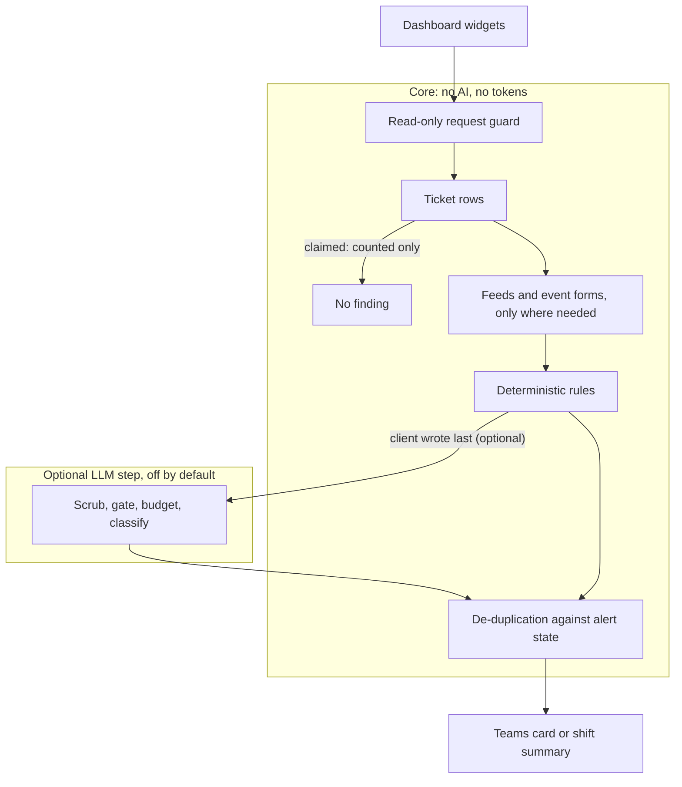
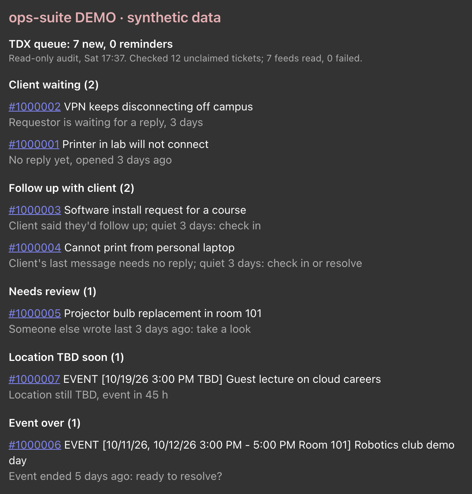

# TDX queue auditor

[](https://github.com/kevfang03/tdx-queue-auditor/actions/workflows/ci.yml)

A read-only auditor for a university IT service desk's TeamDynamix ("TDX") ticket queue. It flags the tickets that have gone quiet, posts them to Microsoft Teams, and sums up everything open at the start of each shift. The core is plain Python rules with no AI. An optional LLM step, off by default, handles the one question rules cannot answer.

## The problem

The desk already gets an alert when something happens to a ticket. Nothing notices when **nothing** happens: a client replied two days ago and nobody answered, a reply came from someone outside the desk, an event is three days out and its room is still "TBD". Finding those meant reading every ticket by hand.

The obvious fix, the TDX REST API, is not available: student staff cannot be issued API keys. So the auditor reads the queue the way a person does, through a browser with the person's own sign-in, and a request guard makes sure that browser can only read.

## What it does

Every 30 minutes during desk hours, `tdx watch` reads the desk's dashboard and applies deterministic rules:

- **Dashboard rows:** the "Unclaimed" and "Claimed by others" widgets, every page. Claimed tickets belong to full-time staff and are only counted.
- **Feeds, only where needed:** a ticket's activity feed is opened only when it is 48+ hours old, is an event request form, or is an event within 14 days. Only entries the client can see count; private notes and status changes are skipped.
- **The 48-hour rules:** *client waiting* (no reply yet, or the client wrote last 48+ hours ago), *needs review* (someone outside the desk wrote last), and *ready to close* (the desk replied last 3+ days ago, shown in summaries only).
- **Events:** dates and locations read from the ticket title and the request form, then *event outreach due*, *event details pending*, *location TBD soon* and *event over, ready to resolve*. Outreach cards carry a fixed checklist, never a drafted reply.
- **Shift summaries:** the day's first summary lists every open finding, the events this week and the tickets ready to close; later slots post only what changed, and nothing at all when nothing did.
- **Teams cards:** one Adaptive Card per cycle, sent only when a finding is new or due again, through a Teams Workflows webhook.



The full rules, with worked examples, are in [docs/tdx-rules.md](docs/tdx-rules.md).

## The optional LLM step

When a client wrote last, a rule cannot tell "I'm still waiting for you" from "thanks, I'll try that and let you know". The optional step asks a small model (Claude Haiku) to classify that one message, so "will follow up" becomes a lower-priority *follow up with client*.

It is **off by default**, and every rule, card and summary works without it. When it is turned on:

- only the client's latest message on a *client waiting* ticket is sent, with quoted mail and sign-off removed and names, emails, phone numbers, IDs and URLs scrubbed; the client accepts only text the scrubber produced;
- live ticket text needs a second, separate switch in the person's own config;
- a daily token budget hard-stops calls, and each message is classified once;
- the model can only pick one of four labels, and every failure (unsure, refusal, error, closed gate, spent budget) keeps the louder *client waiting* finding.

Details: [docs/PRIVACY.md](docs/PRIVACY.md) and [docs/DESIGN.md](docs/DESIGN.md#deterministic-rules-first-an-optional-llm-step-second).

## Demo



*A demo card from synthetic data, with the optional LLM step on (hence "Follow up with client").*

### Try it in 2 minutes

No accounts, no TDX access and no real data. You need [uv](https://docs.astral.sh/uv/). The demo serves invented TDX pages on `127.0.0.1` and runs the real auditor against them, through the same read-only request guard.

```bash
git clone https://github.com/kevfang03/tdx-queue-auditor.git
```

```bash
cd tdx-queue-auditor
```

```bash
uv sync
```

```bash
uv run playwright install chromium
```

```bash
uv run ops-suite tdx demo --no-llm
```

On Windows, `uv sync` downloads uv's own Python 3.12 even when another Python is installed; that is intended ([USAGE](docs/USAGE.md#windows-use-uvs-python)). The output (ticket ids and titles are invented):

```text
Demo: synthetic TDX pages on 127.0.0.1 (no real data, nothing leaves this computer unless --send).
Unclaimed: 21 ticket(s) on 3 page(s).
Claimed by others: 6 ticket(s) on 1 page(s).
Feeds: 17 needed, 17 read, 0 failed, 0 deferred. Entries: 21 (20 reply, 1 private, 0 system), 0 unreadable.
Findings: client waiting 6, follow up with client 0, event outreach due 1, event details pending 1, event over 1, location TBD soon 2, needs review 1, ready to close 1.
LLM: off; 3 "requestor wrote last" findings keep their wording.
Checked: 21 unclaimed (17 feeds needed, 0 missing), 6 claimed (counted only). Events: 6, 1 recurring, 1 multi-date, 0 with an unreadable date, 1 without a location. Event forms: 4 (0 recurring, 0 unreadable); 2 renamed without a form. Event states (no finding): 0 waiting on requester, 1 in progress, 0 outreach not due yet, 1 marketing only, 1 no outreach. Desk members known: 2.
  client_waiting  1000002  requestor_last  76h
  client_waiting  1000003  requestor_last  75h
  client_waiting  1000001  no_reply_yet  74h
  client_waiting  1000004  requestor_last  74h
  client_waiting  1000023  no_reply_yet  50h
  client_waiting  1000026  event_requester_replied  3h
  event_outreach_due  1000019  outreach_due  145h
  needs_review  1000005  other_last  73h
  event_details_pending  1000020  details_pending  72h
  location_tbd_soon  1000007  tbd_soon  49h
  location_tbd_soon  1000025  location_missing  28h
  event_over  1000006  event_over  118h
  ready_to_close  1000022  desk_replied_last  100h
  event_form_missing  1000007
  event_form_missing  1000025
Unreadable dates: 0. Duplicates: 0. Blocked requests: 0. Live updates blocked: 51. Allowed non-GET: 91.
```

Each finding is listed by ticket id, kind, reason code and age in hours (for *event outreach due*, the hours until the event). `--summary` builds the shift summary instead, `--card-json PATH` writes the card for the [Adaptive Cards Designer](https://adaptivecards.io/designer/), and `--send` posts it, marked "DEMO · synthetic data", to your own Teams chat. With an API key saved and without `--no-llm`, the demo also runs the optional LLM step on its synthetic messages. All options: [docs/USAGE.md](docs/USAGE.md#demo).

## Design highlights

- **Read-only by construction.** Every browser request passes a guard that allows reads and a two-entry allowlist of data loads, refuses live-update connections, and counts every exception in the run summary.
- **Rules first, tokens last.** The grid and the feeds settle almost every ticket for free; a cycle with nothing to classify costs $0.00.
- **Privacy enforced in types, not habits.** The LLM client accepts only a `ScrubbedText` that only the scrubber can create.
- **Alerts that do not nag.** Findings are de-duplicated against a small state file; shift summaries post in full once a day, then only the changes.
- **No real data in development.** Selectors were built from structure-only page captures (tags, classes, column headers; every other text a placeholder) and tested on synthetic pages.
- **Sign-in stays human.** The person signs in once, MFA included; on expiry the tool asks again and waits. It never stores a password.

The reasoning behind each, and the rest of the decisions, are in [docs/DESIGN.md](docs/DESIGN.md).

## Results

Piloted with the desk's approval on its live queue:

- **A typical cycle:** 26 unclaimed and 22 claimed tickets read and 7 feeds opened in under a minute, with 0 blocked requests and 0 unreadable dates.
- **Rule tuning** against manual spot-checks cut *client waiting* findings on the same queue from 14 to 4; in the final checked run, all 3 findings were confirmed by manual review.
- **The loop:** 5 cycles over 2 hours, all on schedule. The first sent one card and the next four reported "nothing new", so de-duplication held.
- **The optional LLM step:** a synthetic eval scored 24 of 24 (development set) and 12 of 12 (holdout, run once) with 0 unsafe errors, for about $0.001; on live tickets, 2 of 2 verdicts were judged right, for about $0.0002, and repeat cycles cost nothing.
- **Tests:** more than 1,500, run in CI on Linux, Windows and macOS on every push. No test needs a network, a keychain, a webhook or TDX.

## Future

**A read-only TDX API adapter.** If the TDX administrators grant read-only API access, a second row source would sit behind the same `TicketRow` and `TicketFeed` types, so the rules, alerts and summaries stay unchanged and the browser reader remains as the fallback. It would first run in a shadow mode beside the browser reader, logging counts-only differences between the two sources.

## Documentation

- [docs/USAGE.md](docs/USAGE.md): install, configure and run every command.
- [docs/tdx-rules.md](docs/tdx-rules.md): the rules in plain language, with worked examples.
- [docs/DESIGN.md](docs/DESIGN.md): the architecture and the key decisions.
- [docs/PRIVACY.md](docs/PRIVACY.md): where each kind of data goes, and what never leaves the machine.
- [docs/tdx-page-structure.md](docs/tdx-page-structure.md): the page structure the selectors rely on.

The package and command are named `ops-suite`; the same package also holds an offline scan of a shared mailbox's drop folder (`ops-suite mail scan`), tested on sample mail.

## Licence

[MIT](LICENSE).
